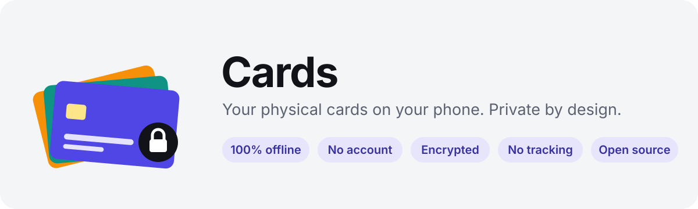

<p align="center">
  
</p>

<p align="center">
  <a href="https://github.com/warwickbuilds/cards/releases/latest"></a>
  <a href="https://github.com/warwickbuilds/cards/releases"></a>
  <a href="LICENSE"></a>
</p>

<p align="center">
  
  
  
  
  
  
</p>

<p align="center">
  <a href="https://github.com/warwickbuilds/cards/actions/workflows/ci.yml"></a>
  <a href="https://github.com/warwickbuilds/cards/actions/workflows/android-release.yml"></a>
  
  
  
  
  
  <a href="CONTRIBUTING.md"></a>
  <a href="https://github.com/warwickbuilds/cards/commits/main"></a>
</p>

<p align="center">
  <a href="https://github.com/warwickbuilds/cards/releases/latest"><b>Download the latest APK</b></a> ·
  <a href="#install">Install guide</a> ·
  <a href="#privacy-first-by-design">Privacy</a> ·
  <a href="#what-it-does">Features</a> ·
  <a href="#for-developers">For developers</a> ·
  <a href="CONTRIBUTING.md">Contributing</a>
</p>

**Cards keeps your physical cards on your Android phone, and nowhere else.** Bank cards, loyalty cards, memberships and IDs, photographed front and back and shown full screen at full brightness when you need them at the counter.

It is a **privacy-first, local-first** card wallet: no account, no login, no cloud, no ads, no analytics, no tracking, no background network traffic and no AI. The only network request Cards can ever make is checking GitHub Releases when you manually tap **Settings → Check for updates**. Everything is **encrypted on your device**, locked behind your fingerprint or face, and **you own your data**: back it up to an encrypted file you keep, and take it with you. Free and open source under the [MIT License](LICENSE), so anyone can check every claim on this page.

## Contents

- [Highlights](#highlights)
- [Privacy first, by design](#privacy-first-by-design)
- [What it does](#what-it-does)
- [Install](#install)
- [Getting started](#getting-started)
- [Your data and privacy](#your-data-and-privacy)
- [FAQ](#faq)
- [For developers](#for-developers): [tech stack](#tech-stack), [status](#status), [features in detail](#features), [changelog](#versions-and-changelog), [architecture](#architecture), [security model](#security-and-privacy), [services](#services), [releases](#releases), [running it](#running-it), [maintenance](#maintenance), [future enhancements](#future-enhancements)
- [Contributing](#contributing), [security](#security), [license](#license) and [acknowledgements](#acknowledgements)

## Highlights

| | |
| --- | --- |
| 📵 **Offline cards, zero background traffic** | Your cards never leave the phone. No servers, no cloud sync, and no background network calls—the only request Cards can make is checking GitHub Releases when you tap **Check for updates** in Settings. |
| 🙅 **No account, no login** | Install and go. No email, no phone number, no sign-up, no password to forget or to be breached. |
| 🔐 **Encrypted at rest** | Every card, photo and note lives in an AES-256 encrypted database (SQLCipher). The key is held by Android's hardware-backed Keystore. |
| 👆 **Biometric app lock** | Fingerprint, face or screen lock on open and after you step away. Screenshots and screen recording are blocked. |
| 💳 **Show it in one tap** | Black screen, full brightness, screen stays awake, pinch to zoom, rotate to fill the screen for barcodes. |
| 🗂️ **Organised your way** | Colour-coded categories you can switch on and off, search, pins, and "most used first". |
| 💾 **Your data, your file** | Encrypted, passphrase-protected backup to a file and folder you choose. Restore on any phone. No cloud required. |
| 🔍 **Open source** | MIT licensed. Read the code, build it yourself, check the APK's permissions and signature. |

## Privacy first, by design

Most wallet and loyalty-card apps want an account, sync to a cloud, show ads, and ship analytics and crash-reporting SDKs that phone home. Cards does none of that. Your card photos are some of the most sensitive pictures on your phone, so Cards is built on **privacy by design and privacy by default**: there is no server, so there is nothing to collect, nothing to sell and nothing to breach.

| | Cards | Typical wallet / loyalty-card app |
| --- | --- | --- |
| Background network access | ❌ **None** (manual GitHub update check only) | ✅ Always |
| Account or login | ❌ **Never** | Usually required |
| Cloud sync of your cards | ❌ **Never** | Often on by default |
| Ads, analytics, telemetry, crash reporting | ❌ **Zero** | Common |
| Third-party SDKs that send data | ❌ **None** | Common |
| AI or "smart" features that upload photos | ❌ **None** | Increasingly common |
| Encrypted on the device | ✅ **AES-256, hardware-backed key** | Varies |
| App lock | ✅ **Fingerprint, face or PIN** | Sometimes |
| Screenshot and recent-apps protection | ✅ **On by default** | Rare |
| Google cloud backup of your data | ❌ **Switched off on purpose** | Often on |
| Export your own data | ✅ **Encrypted file you choose where to keep** | Rare |
| Source code you can audit | ✅ **Open source, MIT** | Rarely |

**What that means in practice**

- **Zero data collection.** Cards collects nothing. There's no developer server, no analytics, no telemetry, no crash reports, no usage stats, no advertising ID.
- **Offline cards, manual-only update check.** Cards works completely offline and never calls the network on launch or in the background. The only network call in the codebase is an unauthenticated `GET` to GitHub's public releases API (`src/lib/updates.ts`, enforced by a static test) when you tap **Settings → Check for updates**. [Check it yourself](#check-it-yourself).
- **No account, no identity.** The app never knows who you are. Nothing to sign up for, nothing to log in to, no password reuse risk.
- **Encrypted at rest.** The whole database, photos included, is encrypted with SQLCipher (AES-256). The 256-bit key is random, made on your phone, and protected by the hardware-backed Android Keystore. Photos are stored **inside** the encrypted database, never as loose image files.
- **Locked when you're not looking.** Biometric or PIN app lock, re-locking after the time you choose. `FLAG_SECURE` blocks screenshots and screen recording and blanks the app in the recent-apps switcher.
- **Minimal permissions.** Only Camera (to photograph a card), Biometric (for the lock) and Internet (solely for manual update checks). Storage, media, microphone, location and network-state permissions are explicitly blocked. The gallery uses Android's private photo picker.
- **Data ownership and portability.** Your cards are yours. Export them any time to an encrypted `.cardsbackup` file (PBKDF2 + AES-256-GCM, with your passphrase), keep it wherever you like, and restore it on another phone.
- **Nothing in Google's cloud.** Android's automatic cloud backup is switched off for Cards, so your card photos never end up in a Google Drive backup.
- **Transparent and auditable.** Every line is open source, every release is built by GitHub Actions from this repo, and every APK is signed with one published certificate.

Read the full [Privacy policy](PRIVACY.md) (it's short, because there's nothing to collect) and the technical [security model](#security-and-privacy).

### Check it yourself

You don't have to take our word for it. With the Android SDK build tools on a computer:

```bash
# Minimal permissions: only CAMERA, USE_BIOMETRIC and INTERNET (no storage/media/mic/location)
aapt2 dump permissions cards-<version>-arm64.apk

# Signed with the published release certificate (see SECURITY.md)
apksigner verify --print-certs cards-<version>-arm64.apk
```

On the phone itself: **Settings → Apps → Cards → Permissions** shows only Camera and Biometric, and **Mobile data & Wi-Fi** shows zero background data used (only tiny manual GitHub release checks when you tap **Check for updates**).

## What it does

- **Add a card in seconds.** Snap the front and back (or pick from the gallery), cropped to card shape automatically. Give it a name, a category and optional notes.
- **Show it at the counter.** Tap a card: black screen, brightness up, screen stays on. Flip front and back, pinch or double-tap to zoom, rotate it sideways to fill the screen so barcodes scan first time, or tap for an immersive view with nothing else on screen.
- **Find it fast.** Pinned cards first, then your categories in your order. "Most used first" puts the card you reach for at the top. Search matches names, notes and categories, ignoring case and accents.
- **Categories you control.** Bank, Loyalty, ID and Membership to start. Rename, recolour (11 colours), reorder, add your own, and switch a whole category off to hide it from home.
- **Locked and private.** App lock with fingerprint, face or screen lock; screenshots blocked; blank in recent apps.
- **Encrypted backup and restore.** Back up to a passphrase-protected file in a folder you choose (Downloads, a USB drive, anywhere). Restore by adding to your cards or replacing them; a restore either fully works or changes nothing.
- **Light and dark.** Follows your phone. The card viewer is always black, which scanners and OLED screens like best.

## Install

Cards isn't on the Play Store (that would mean a Google developer account, Play services and policies it doesn't need). You install the signed APK straight from GitHub Releases.

1. On your Android 16+ phone (Pixel 10 and newer), open the [latest release](https://github.com/warwickbuilds/cards/releases/latest) and download `cards-<version>-arm64.apk`.
2. Open the downloaded file. Android asks whether your browser (or Files app) may install unknown apps. Tap **Settings**, turn on **Allow from this source**, then go back and tap **Install**. You only need to do this once.
3. **Play Protect** may say the app is unrecognised because it isn't from the Play Store. Tap **More details → Install anyway**.
4. Open Cards. That's it: no sign-up screen.

**Updating**: Cards never checks the network in the background. Whenever you want to check for a new version, open **Settings → Check for updates** and tap **Download** if a newer release is available—or visit [Releases](https://github.com/warwickbuilds/cards/releases) directly (press **Watch → Custom → Releases** on GitHub to be emailed). Install the new APK over the old one and your cards are kept. Every release is signed with the same key, so this always works. If Android ever says the app "conflicts with an existing package", the APK was signed with a different key: **don't uninstall to get around it, because that deletes your cards.** Make a backup first.

Builds from pull requests are signed with a debug key and can't be installed over a release.

## Getting started

1. Open Cards. If your phone has a screen lock, the app lock is already on (after 1 minute in the background); change it in **Settings**.
2. Tap **+** to add your first card. Tap the front slot, take a photo, and crop it. Do the same for the back.
3. Give it a name, pick a category (or tap **New…**), and save. It opens straight away so you can see how it'll look at the till.
4. Long-press any card to **Edit**, **Pin** or **Delete**. Manage categories with the folder button at the top of home, and settings with the gear next to it.
5. Go to **Settings → Back up** and make your first encrypted backup. Keep the file and its passphrase somewhere safe.

Reinstalling or on a new phone? Go to **Settings → Restore**, pick your `.cardsbackup` file and enter its passphrase.

## Your data and privacy

- **Everything stays on your phone.** Your cards, photos, notes and settings never leave your device. No account, no ads, no analytics, no AI, and no background network traffic (only a manual **Settings → Check for updates** check against GitHub Releases when you tap it).
- Your cards, photos and notes are stored in an **encrypted database**. The key is kept in Android's hardware-backed Keystore and never leaves the phone.
- **Uninstalling the app, or clearing its storage, deletes your cards permanently.** Android's own cloud backup is switched off for this app on purpose (so your card photos never end up in a Google backup), and there's no Cards cloud to recover from. Make a backup in **Settings → Back up** and keep the file somewhere safe, ideally off the phone.
- Backups are encrypted with a passphrase you choose. Without the passphrase nobody, including you and including us, can open one, so don't forget it.
- **Delete everything** in Settings wipes every card, photo and custom setting, and resets categories back to the defaults (after your fingerprint or PIN).
- The full details are in the [Privacy policy](PRIVACY.md).

## FAQ

**Can Cards pay at a terminal with NFC like Google Wallet?**
No. It shows a photo of your card for things like loyalty barcodes, membership checks or reading a number. Tap-to-pay needs a bank's tokenised integration, which needs a network and an account. Cards deliberately has neither.

**Is it safe to keep photos of bank cards in it?**
Safer than in your gallery, which is unencrypted and often synced to the cloud. In Cards they're encrypted, locked behind your biometrics, hidden from screenshots and never uploaded. See the [security model](#security-and-privacy) for the honest limits (for example, someone who knows your phone's PIN can open the app).

**What happens if I lose my phone?**
Without your screen lock, the app won't open, and the database on the storage is encrypted. To get your cards back on a new phone you need a backup file and its passphrase, so make one now.

**Why no cloud sync?**
Because the safest data is data that never leaves the device. A cloud means an account, a server, a company holding your card photos and a target for breaches. Use an encrypted backup file and move it yourself.

**Why isn't it on the Play Store?**
It may be one day. For now, GitHub Releases keeps it simple, free and transparent: the APK is built in public from this repo.

---

# For developers

Everything below is about how the app is built, released and maintained.

`docs/DESIGN.md` explains the UX research and design choices. `AGENTS.md` has the Expo rules for this SDK. `CLAUDE.md` has the standing rules for every PR.

## Tech stack

<p>
  
  
  
  
  
  
  
  
</p>

| Layer | What's used |
| --- | --- |
| App | Expo SDK 58 (development build, not Expo Go), React Native 0.88 (Hermes V1), React 19, TypeScript 6, Expo Router, Android 16+ (API 36, `arm64-v8a` only) |
| Data | SQLite with SQLCipher (AES-256, WAL + `synchronous=NORMAL`) through expo-sqlite; plain SQL with numbered migrations (`PRAGMA user_version`); photos as JPEG inside the database; scoped store invalidation |
| Keys and crypto | expo-secure-store (Android Keystore) for the database key; expo-crypto AES-256-GCM and @noble/hashes PBKDF2 for backups |
| Security | expo-local-authentication (biometric lock), expo-screen-capture (`FLAG_SECURE`), `allowBackup: false`, `networkInspector: false`, static test restricting `fetch` to manual GitHub update checks |
| UI | Custom tokens with light and dark mode, lucide icons, Reanimated and Gesture Handler for zoom and pan |
| Phone features | expo-image-picker (camera and system photo picker), expo-image-manipulator (single-decode crop, rotate, resize), expo-brightness, expo-keep-awake |
| Quality | Jest (jest-expo + real SQLite `node:sqlite` repo tests), TypeScript, ESLint, `expo-doctor`, and CI + APK verification workflows on pull requests |
| Releases | GitHub Actions builds and signs a single R8-shrunk `arm64-v8a` APK (Android 16+ / Pixel 10+, uncompressed 16 KB-aligned `.so`) with Gradle, verifies minimal permissions with `aapt2`, and publishes to GitHub Releases |

Full versions are in [Main dependency versions](#main-dependency-versions).

## Developer contents

- [Tech stack](#tech-stack)
- [Status](#status)
- [Features](#features)
- [Versions and changelog](#versions-and-changelog)
- [Architecture](#architecture)
- [Security and privacy](#security-and-privacy)
- [Services](#services)
- [Releases](#releases)
- [Running it](#running-it)
- [Maintenance](#maintenance)
- [Future enhancements](#future-enhancements)
- [Contributing](#contributing), [Security](#security), [License](#license), [Acknowledgements](#acknowledgements)

## Status

Version **0.3.0** (PR #6): adds manual-only GitHub Releases update checker and an **About** section with app details and GitHub links in Settings.

| Area | State |
| --- | --- |
| Cards: add, edit, delete, front and back photos, notes, pin | Done (PR #1, #5) |
| Categories: add, rename, colour, reorder, switch on/off, delete | Done (PR #1, #5) |
| Home: grouped by category, pinned first, search, category chips, sort | Done (PR #1, #5) |
| Full-screen viewer: full brightness, keep awake, zoom, rotate, immersive | Done (PR #1, #5) |
| Security: encrypted database, app lock, screenshot blocking, minimal permissions | Done (PR #1, #2, #5, #6) |
| Encrypted backup and restore (merge or replace) | Done (PR #1, #5) |
| Manual update checker, direct APK download link & About/GitHub links in Settings | Done (PR #6) |
| Signed APKs on GitHub Releases | Done (v0.1.0, v0.1.1, v0.2.0, v0.3.0; single `arm64-v8a` APK from v0.2.0) |
| Open source polish: privacy-first README, banner and badges, privacy policy, security policy, contributing guide, code of conduct, issue templates | Done (PR #3) |
| Cloud dev environment setup (`.agents/environment.json`) | Done (PR #4) |
| Tested on a real phone | 0.1.0 failed on first launch (fixed in 0.1.1); 0.3.0 ready for Pixel 10 testing |
| Screenshots in the README | Planned (needs demo cards, never real ones) |

## Features

The detailed list of what works now.

### Home

- Cards are shown as card-shaped photos in two columns (front photo, falling back to back if only the back was photographed), with the name underneath (never written over the photo).
- **Pinned** cards come first, then one section per category (in your order, with its colour), then cards with no category.
- **Search** matches names, notes and category names, ignoring case and accents. It also finds cards in switched-off categories.
- **Category chips** filter to one category.
- **Order**: most used first (default), A to Z, or newest first. Settings → Order.
- **Long-press** a card for Edit, Pin and Delete.
- Switched-off categories are hidden; a note at the bottom says how many cards are hidden, with a **Show** button.

### Showing a card

- Opens on a black screen at **full brightness** (toggle with the sun button; default in Settings) and keeps the screen on.
- **Front/Back** switch (shown when both sides have photos), **pinch or double-tap to zoom**, drag when zoomed.
- **Rotate** turns the card sideways to fill the screen, handy for barcodes.
- **Tap the card** for an immersive view with nothing else on screen (Android back exits immersive view first).
- Name, category and notes underneath (notes can be selected and copied).
- Every opening is counted for "Most used first".

### Adding and editing

- Two card-shaped photo slots. Tap one to **take a photo**, **choose from the gallery**, **rotate** or **remove**.
- Photos are cropped to the shape of a bank card by default (Android's crop screen). Turn off **Crop photos to card shape** in Settings for odd-shaped cards.
- Name, category (chips, plus **New…** to make one on the spot), notes and **Pin to top**.
- Leaving with unsaved changes asks first. After adding a card it opens straight away.

### Categories

- Starts with Bank, Loyalty, ID and Membership. Rename, recolour (11 colours), reorder with the arrows, add or delete.
- The **switch** turns a category on or off. Off categories and their cards are hidden from home.
- Deleting a category keeps its cards (they move to "No category").

### Settings

- **App lock** (fingerprint, face or screen lock) and **Lock again** after immediately, 30 seconds, 1, 5 or 15 minutes in the background. Default on, after 1 minute. Needs a screen lock on the phone.
- **Block screenshots** (default on): also blanks the app in the recent-apps view.
- **Full brightness**, **Order**, **Show switched-off categories**, **Crop photos to card shape**.
- **Back up**, **Restore**, **Delete everything** (asks for your fingerprint/PIN first; resets categories back to the defaults).
- **Updates**: shows the installed version and checks GitHub Releases on tap (never in the background), offering a direct `arm64` APK download link and release notes link when a newer version is out.
- **About**: basic app details (version, MIT license, encryption/privacy summary) and direct links to the GitHub repository, Releases, Privacy policy and Issues.

### Backup and restore

- **Back up**: choose a passphrase (with a strength meter), choose a folder (for example Downloads or a USB drive), and Cards writes `cards-YYYY-MM-DD.cardsbackup`.
- **Restore**: pick the file, enter the passphrase, see what's inside, then **Add to my cards** (keeps what's on the phone; cards in both are updated) or **Replace all my cards**. A restore either fully succeeds or changes nothing.

## Versions and changelog

| Version | Date | PR | Changes |
| --- | --- | --- | --- |
| 0.3.0 | 2026-11-26 | #6 | Added manual-only **Settings → Updates** checker against GitHub Releases with trusted-URL direct `arm64` APK download & release notes links (`src/lib/version.ts`, `src/lib/updates.ts`; no background checks, enforced by static `fetch` guard test), plus a **Settings → About** section with app details and links to the GitHub repo, Releases, Privacy policy and Issues. Enables `INTERNET` solely for manual update checks while keeping all blocked permissions verified in CI (`aapt2`), and updates README, PRIVACY, SECURITY, CLAUDE and CONTRIBUTING docs. |
| 0.2.0 | 2026-11-26 | #5 | Pixel 10+ / Android 16 (API 36) `arm64-v8a`-only build with R8 minification, resource shrinking, direct uncompressed native libs (`useLegacyPackaging: false`), and dropped iOS/web config and unused native deps (`@expo/vector-icons`, `expo-document-picker`, `expo-sharing`, `react-dom`, `react-native-web`). Security hardening: hide `<Modal>` sheets when locked, defer mounting navigation/card data until initial unlock, bound `expectExternal` grace window (5 min) and clear after permission denial, clear restore passphrase after decrypt, guard DB key overwrite on existing file, tighten backup version/format/dimension checks, and verify SQLCipher + permissions in CI. Performance & bug fixes: scoped store invalidation, single resolved thumbnail query (fixes back-only cards), rotated zoom pan bounds, stale category filter recovery, single-decode photo prep with native ref release, zero-fade card rendering, hardware back exit from immersive mode, `NULL`-preserving restore merge, starter-category re-seed on Delete everything, keyboard-aware sheets, and real SQLite repo tests. |
| 0.1.1 (dev) | 2026-11-26 | #4 | Dev environment only, no app change: add `.agents/environment.json` so cloud dev environments automatically install locked dependencies with `npm ci`. |
| 0.1.1 (docs) | 2026-11-26 | #3 | Docs and repo only, no app change: privacy-first README with banner, badges, highlights, a privacy comparison and FAQ, user guide first and developer details below; new PRIVACY.md, CODE_OF_CONDUCT.md and CONTRIBUTING.md; fuller SECURITY.md with the release certificate; bug and feature issue forms. |
| 0.1.1 | 2026-11-26 | #2 | Fix: 0.1.0 stopped on launch with "file is not a database". Writes ran on a second database connection that never got the encryption key. All writes now run, one at a time, on the one encrypted connection (`src/db/transaction.ts`). An install of 0.1.0 opens fine after updating, no reinstall needed. |
| 0.1.0 | 2026-11-26 | #1 | First version: cards with front/back photos and notes, categories with on/off, home grouped by category with search, full-brightness viewer with zoom and rotate, app lock, encrypted database, encrypted backup and restore, no internet permission. |

### Main dependency versions

| Package | Version |
| --- | --- |
| Expo SDK | 58.1.0 |
| React Native | 0.88.1 |
| React | 19.3.0 |
| expo-router | 58.0.33 |
| expo-sqlite (with SQLCipher) | 58.0.18 |
| expo-secure-store | 58.0.3 |
| expo-crypto (AES-GCM) | 58.0.9 |
| expo-local-authentication | 58.0.3 |
| expo-screen-capture | 58.0.6 |
| expo-brightness | 58.0.3 |
| expo-image / image-picker / image-manipulator | 58.0.19 / 58.0.10 / 58.0.16 |
| react-native-gesture-handler | 3.3.0 |
| react-native-reanimated | 4.7.1 |
| @noble/hashes (PBKDF2) | 2.4.0 |
| lucide-react-native | 1.80.0 |
| TypeScript | 6.0.3 |

Android 16 (API 36) and newer (`arm64-v8a`, Pixel 10 and above).

## Architecture

```
Screens (src/app, Expo Router stack — deferred on launch until initial unlock)
   │  read through live hooks (src/db/DataProvider.tsx: useWallet, useCard, useSettings…)
   │  write through small functions (src/db/repo.ts), which bump scoped counters (src/db/store.ts)
   │  every write is queued and wrapped in a transaction on the one keyed connection (src/db/transaction.ts)
   ▼
SQLite + SQLCipher on the phone (src/db/database.ts, schema and migrations in src/db/schema.ts)
   key: 256-bit random, in expo-secure-store (Android Keystore)
   photos: JPEG base64 inside the database (card_image table), never loose files

Pure logic (src/lib: wallet grouping and sorting, search, backup format and checks,
lock timing, passphrase strength) has no native imports and is unit tested.
The SQLite repository (src/db/repo.ts) is integration tested against real SQLite (node:sqlite).
```

Why this shape (and not the calories-and-steps one): that app uses Drizzle and stores photos as files. Cards keeps photos **inside the encrypted database** so they share its encryption, a card is always saved whole in one transaction, and there are no image files to leak or clean up. With only four tables, plain SQL with numbered migrations (`PRAGMA user_version`) is simpler than an ORM and has fewer dependencies.

### Screens

| Route | File | What |
| --- | --- | --- |
| `/` | `src/app/index.tsx` | Home grid, search, chips, long-press menu, Add button |
| `/card/[id]` | `src/app/card/[id].tsx` | Full-screen viewer |
| `/edit` | `src/app/edit.tsx` | Add (no `id`) or edit (`?id=`) a card |
| `/categories` | `src/app/categories.tsx` | Manage categories |
| `/settings` | `src/app/settings.tsx` | Settings |
| `/backup` | `src/app/backup.tsx` | `?mode=export` or `?mode=import` |

### Tables

| Table | Holds |
| --- | --- |
| `category` | id, name, colour key, active, sort order |
| `card` | id, category (nullable, set to null if the category is deleted), title, notes, pinned, use count, last used, timestamps |
| `card_image` | card id + side (front/back), full JPEG and thumbnail (base64), size. Deleted with the card. |
| `setting` | key/value JSON for the settings |

Migrations: append to `MIGRATIONS` in `src/db/schema.ts`; never edit a shipped one.

### Folder layout

```
src/app/         screens (Expo Router)
src/components/  UI pieces: CardTile, CardArt, ZoomableImage, PhotoSlot, CategorySheet, LockScreen, ui.tsx
src/db/          database, schema, repo (reads/writes), DataProvider hooks, scoped change store
src/lib/         pure logic + photo, backup IO and AES helpers
src/security/    app lock and screenshot blocking
src/theme/       colours, tokens, light/dark
plugins/         config plugins: release signing, version code
docs/DESIGN.md   UX research and design decisions
docs/banner.svg  README banner (follows light and dark mode)
.agents/         cloud development environment setup (environment.json)
.github/         CI and release workflows, PR template, issue forms
PRIVACY.md, SECURITY.md, CONTRIBUTING.md, CODE_OF_CONDUCT.md   project policies
```

## Security and privacy

| Threat | Protection |
| --- | --- |
| Data leaving the phone | No developer servers, analytics, crash reporting or background network calls. The **only** `fetch()` allowed in `src/` is the manual **Settings → Check for updates** request to GitHub's public releases API (`src/lib/updates.ts`), enforced by a static unit test (`src/lib/__tests__/version.test.ts`), and update links are strictly validated against `https://github.com/warwickbuilds/cards/releases/`. |
| Someone with the unlocked phone | App lock with Android's biometric prompt or screen lock (`expo-local-authentication`), on launch and after the chosen time in the background. Screens aren't mounted before initial unlock, bottom-sheet modals hide automatically while locked, and external camera/picker flows use a bounded 5-minute grace window. |
| Shoulder-surfing / screenshots / recent apps | `FLAG_SECURE` (`expo-screen-capture`) blocks screenshots and screen recording and blanks the app in the app switcher. |
| Phone storage read off the device | Database encrypted with SQLCipher (AES-256). Key is 32 random bytes in `expo-secure-store`, encrypted by the hardware-backed Android Keystore (never silently overwritten if an encrypted database already exists). `secure_delete` overwrites deleted rows. |
| Leftover photo files | Camera, crop and resize outputs are deleted immediately after reading; native image refs are released; cache folders are swept on launch and after capture. `expo-image` is told not to cache card photos on disk. |
| Cloud/adb backups | `allowBackup: false`, so Android never copies the database (or its key) into Google backups. |
| Backup files | `.cardsbackup`: PBKDF2-HMAC-SHA256 (150,000 iterations, random salt) → AES-256-GCM with the header as authenticated data. Wrong passphrase or any tampering fails cleanly, and passphrases are cleared from state right after encrypting or decrypting. Restored data is validated (header version, format, ids, sizes, positive dimensions, JPEG signatures, references) before anything is changed, and applied in one transaction. |
| Over-broad permissions | Only Camera, Biometric and Internet (manual update checks only). Microphone, storage, media, location, contacts, overlay, settings and network-state permissions are explicitly blocked and verified in CI (`aapt2 dump permissions`). The gallery uses Android's photo picker (no storage permission). |

Release APKs are signed with one key; its certificate SHA-256 is `5d88d9a692842701578e71c4456eaceaabe5a46639dad2f508359d122c0bad5e` (see [SECURITY.md](SECURITY.md#checking-a-download)).

Limits worth knowing: anyone who knows your phone's screen-lock PIN can open the app (that's how Android biometrics work); a rooted or compromised phone can read app memory while it's unlocked; and a backup is only as strong as its passphrase.

## Services

- **GitHub Releases API** (`api.github.com/repos/warwickbuilds/cards/releases/latest`): called **only** when you tap **Settings → Check for updates**. Unauthenticated, read-only, no keys, no accounts, and never called in the background.

Android permissions used: **Camera** (taking photos, asked the first time), **Biometric** (app lock), **Internet** (manual update checks only).

## Running it

```bash
npm ci
npm test                     # unit + SQLite repo tests (jest)
npm run typecheck            # TypeScript
npm run lint                 # ESLint (Expo + React Compiler rules)
npx expo-doctor              # SDK & dependency health check
npx expo export -p android   # bundle check
npm run android              # development build on a Pixel 10+ / Android 16+ device or emulator
```

Expo Go can't run this app (SQLCipher and other native modules); use a development build.

## Releases

Release APKs are built and signed by GitHub Actions (`.github/workflows/android-release.yml`) with `expo prebuild` + Gradle: a single R8-shrunk `arm64-v8a` APK targeting Android 16+ (API 36, Pixel 10 and newer).

### One-time setup: the release key

Android only installs an update signed with the same key as the installed app, so make one key and keep it safe (password manager plus an offline copy). Use a **new key for Cards** (alias `cards`), not the calories-and-steps one.

1. Make the key (Windows PowerShell, one line):

   ```powershell
   & "C:\Program Files\Android\Android Studio\jbr\bin\keytool.exe" -genkeypair -v -storetype PKCS12 -keystore cards-release.jks -alias cards -keyalg RSA -keysize 4096 -validity 36500 -dname "CN=Cards"
   ```

   macOS/Linux: the same `keytool -genkeypair …` command without the path.
2. Encode it: `[Convert]::ToBase64String([IO.File]::ReadAllBytes("cards-release.jks")) | Set-Content keystore.txt` (or `base64 -i cards-release.jks | tr -d '\n' > keystore.txt`).
3. Get the fingerprint: `keytool -list -v -keystore cards-release.jks -alias cards`, copy the `SHA256:` line.
4. In **Settings → Secrets and variables → Actions**, add `ANDROID_KEYSTORE_BASE64`, `ANDROID_KEYSTORE_PASSWORD`, `ANDROID_KEY_ALIAS` (`cards`), `ANDROID_KEY_PASSWORD` and optionally `ANDROID_CERT_SHA256`.
5. Delete `keystore.txt`.

### Making a release

1. In a PR, bump `version` in `app.json` and `package.json` and add a changelog row.
2. After it merges, on GitHub open **Releases → Draft a new release**, create tag `v<version>` on `main` and publish. The workflow builds, verifies permissions and signature, and attaches `cards-<version>-arm64.apk`.

Pull requests that touch the build set-up also build the `arm64-v8a` APK (debug-signed if no key is set up) and keep it as an artifact for 7 days.

## Maintenance

- **Upgrading Expo**: follow `AGENTS.md` (read the versioned docs, use `npx expo install --fix` and `npx expo-doctor`). The release workflow automatically checks that `expo.sqlite.useSQLCipher=true`, `reactNativeArchitectures=arm64-v8a`, and `android.minSdkVersion=36` land in `android/gradle.properties`, and that blocked permissions stay absent from the built APK (`aapt2 dump permissions`).
- **Transactions**: use `inTransaction` from `src/db/transaction.ts`. Never use expo-sqlite's `withExclusiveTransactionAsync` or `useNewConnection`: they open a second connection without the SQLCipher key and every write fails with "file is not a database". A test fails if either appears in `src`.
- **Database changes**: append a migration; add any new table to `exportAll`/`importAll` in `src/db/repo.ts` and to `parsePayload` in `src/lib/backupData.ts`; bump `DATA_FORMAT` if old apps can't read the new backups.
- **Backup file format** changes: bump `FILE_VERSION` in `src/lib/backupCrypto.ts` and keep reading the old one.
- **Never** commit real card photos or numbers. Tests use tiny fake JPEG bytes.

## Future enhancements

- **NFC**: read a contactless card's public details (card type, last four digits, expiry) to fill in the title and notes automatically. Android's NFC reader mode can do this offline with `react-native-nfc-manager`. Note: phones can't *emulate* bank cards (that needs a bank's tokenised Google Wallet integration), but they can store and replay simple loyalty/access card IDs on some readers via Host Card Emulation, which is worth a look for gym or building tags.
- **NFC tags**: tap a sticker (for example on your keyring) to jump straight to a card.
- **Barcode and QR scanning**: scan a loyalty card's barcode once (on-device, `expo-camera`) and redraw it crisp and full width, which scans more reliably at checkouts than a photo. Uses no AI and stays offline.
- **Automatic card edge detection and perspective correction** when taking a photo (on-device document scanner, for example ML Kit's offline scanner), instead of manual cropping.
- **Home-screen widget** or app shortcut for one-tap access to a pinned card (would bypass the app lock, so opt-in only).
- **Expiry reminders**: an expiry date field with a local notification a month before.
- **Drag to reorder** cards and categories instead of arrows.
- **Swipe between cards** in the full-screen viewer.
- **Wear OS** tile showing a pinned card's barcode.
- **Duplicate detection** when adding a card with the same name.
- **Scheduled reminder to back up**, since uninstalling deletes everything.
- **Hardware-bound key with biometrics** (`requireAuthentication` on the database key) for even stronger at-rest protection, at the cost of losing data if fingerprints are re-enrolled.
- **Optional decoy/stealth mode**: hide sensitive categories behind a second unlock.
- **Screenshots in this README** made with demo cards (never real ones), in light and dark.
- **F-Droid listing**: Cards is offline, open source and has no proprietary services, which is exactly what F-Droid is for. Needs reproducible-build checks.
- **Reproducible builds**, so anyone can rebuild an APK from a tag and get the same bytes as the release.
- **Play Store listing**, with a Data Safety form that says "No data collected, no data shared".

## Contributing

Bug reports, ideas and pull requests are welcome. Read [CONTRIBUTING.md](CONTRIBUTING.md) for the ground rules (fully offline, no network, analytics or AI; no real card photos in the repo; every PR updates this README) and how to run the checks. Everyone taking part follows the [Code of Conduct](CODE_OF_CONDUCT.md).

- [Report a bug](https://github.com/warwickbuilds/cards/issues/new?template=bug_report.yml)
- [Suggest an idea](https://github.com/warwickbuilds/cards/issues/new?template=feature_request.yml)

## Security

Please report security problems privately through the repo's [Security tab](https://github.com/warwickbuilds/cards/security), not as a public issue. [SECURITY.md](SECURITY.md) explains what's in scope, how the release keystore is kept out of the repo, and how to check an APK's signature. [PRIVACY.md](PRIVACY.md) is the privacy policy.

## License

[MIT](LICENSE) © 2026 warwickbuilds. You're free to use, change and share the code, as long as the copyright notice comes with it.

The Code of Conduct is adapted from the [Contributor Covenant](https://www.contributor-covenant.org) (CC BY 4.0).

## Acknowledgements

- [Expo](https://expo.dev) and [React Native](https://reactnative.dev)
- [SQLCipher](https://www.zetetic.net/sqlcipher/) by Zetetic, for the encrypted database
- [@noble/hashes](https://github.com/paulmillr/noble-hashes) by Paul Miller, for audited PBKDF2
- [lucide](https://lucide.dev) icons
- [Catima](https://catima.app), the open-source offline loyalty-card app, for showing how it should be done
- Badges by [shields.io](https://shields.io)
